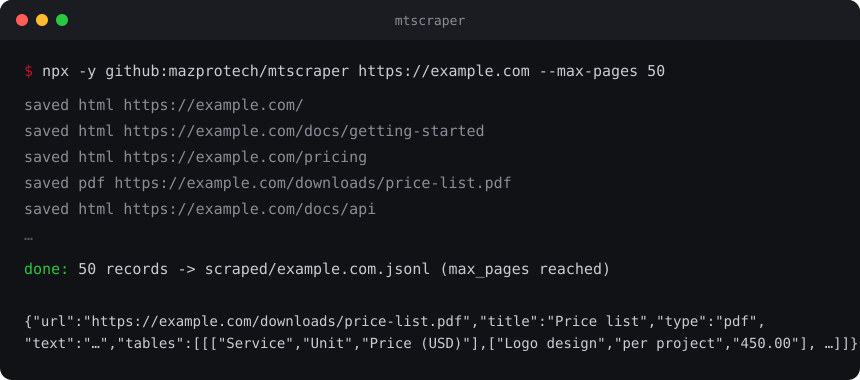

# MTScraper

[](https://github.com/mazprotech/mtscraper/actions/workflows/test.yml) [](LICENSE) [](https://nodejs.org)

**Free website crawler for AI coding agents**, by [MazTech](https://maztech.me).

Ask your agent to *"scrape example.com"*. MTScraper crawls the site, follows its internal links, and saves each page's clean main text (no menus or footers) to JSONL or CSV. Linked PDFs are read too, text and tables. Then your agent works with the data for you.

Free, open source, no credits, no page caps, no API key, runs on your PC.



- Clean text: main content only, extracted with Mozilla Readability
- Linked PDFs: text and tables extracted by default (`--no-pdf` to skip)
- JavaScript sites: optional headless Chromium rendering (`--js`)
- One-page apps: clicks through tabs and buttons and saves every view (`--click`)
- Resumable: stop a big crawl and pick it up later (`--resume`)
- Polite: obeys robots.txt and stays on the target domain
- One record format for everything: `url`, `title`, `view`, `type`, `text`, `tables`
- Node.js only, nothing to install: runs through `npx`

## Why MTScraper

- Runs on your machine. Pages and PDFs are never uploaded anywhere.
- No account, no API key, no per-page credits. A crawl of 5 pages or 5,000 costs the same: nothing.
- One record format for HTML pages and PDFs, so the data is ready for a database, a spreadsheet or an embedding index without cleanup.
- Works inside the agents people already use. Claude Code, Codex, Gemini CLI, Cursor and Copilot pick it up as a skill or an MCP server.
- Polite by default: robots.txt obeyed, four requests at a time, stays on the target domain.
- A few hundred lines of plain JavaScript you can read in one sitting.

## How it works

1. The start URLs go into a [Crawlee](https://crawlee.dev) crawler: robots.txt is checked, links on the same domain are followed, failed requests are retried, and at most four requests run at once.
2. Each HTML page goes through Mozilla Readability, which keeps the main content and drops menus, footers and ads.
3. Each linked PDF is downloaded and read with pdf.js. Lines are rebuilt from the text positions, and lines whose cells line up become tables.
4. Every page becomes one record with the same six fields, appended to a JSONL or CSV file as it arrives.
5. With `--js`, pages are rendered in headless Chromium first. With `--click`, each matching tab or button is clicked and every new view is saved as its own record.
6. With `--mcp`, the same crawler is exposed as one MCP tool, `crawl`, over stdio.

## Requirements

- [Node.js](https://nodejs.org) 20 or newer
- An AI agent that can run skills or MCP servers (see [Install](#install--where-it-works)), or just a terminal
- Chromium, once, only for `--js`, `--click` and `buttons`: `npx -y github:mazprotech/mtscraper setup`

## Install / where it works

MTScraper reaches your agent in two ways, and both run the same tool through `npx -y github:mazprotech/mtscraper`:

- **Skill**: a folder (`skills/mtscraper`) with instructions the agent reads. The agent runs the CLI itself.
- **MCP server**: your app starts `npx -y github:mazprotech/mtscraper --mcp` and gets one tool, `crawl`.

To copy the skill folder, clone the repo once and copy `skills/mtscraper` into the skills folder listed for your tool below (`~` is your home folder; in PowerShell use `$HOME`).

```bash
git clone https://github.com/mazprotech/mtscraper.git
mkdir -p ~/.claude/skills && cp -r mtscraper/skills/mtscraper ~/.claude/skills/    # example: Claude Code
```
```powershell
git clone https://github.com/mazprotech/mtscraper.git
New-Item -ItemType Directory -Force "$HOME\.claude\skills" | Out-Null              # example: Claude Code
Copy-Item -Recurse -Force mtscraper\skills\mtscraper "$HOME\.claude\skills\"
```

Every MCP client needs the same values: command `npx`, arguments `-y github:mazprotech/mtscraper --mcp`. In the clients that use an `mcpServers` JSON file it looks like this:

```json
{
  "mcpServers": {
    "mtscraper": {
      "command": "npx",
      "args": ["-y", "github:mazprotech/mtscraper", "--mcp"]
    }
  }
}
```

### Claude Code
Plugin (recommended). Inside Claude Code, run:
```
/plugin marketplace add mazprotech/mtscraper
/plugin install mtscraper@maztech
```
Or copy the skill folder to `~/.claude/skills/` (all projects) or `.claude/skills/` (one project). Restart Claude Code, or run `/reload-plugins` after a plugin install.

### Claude Desktop
MCP only. Open Settings, Developer, Edit Config, or edit the file directly:
- macOS: `~/Library/Application Support/Claude/claude_desktop_config.json`
- Windows: `%APPDATA%\Claude\claude_desktop_config.json`

Add the `mcpServers` block above (merge it with any servers you already have), then fully quit and restart Claude Desktop.

### OpenAI Codex (the "ChatGPT" option)
"Works with ChatGPT" here means **Codex**: the Codex CLI, the Codex IDE extension and the ChatGPT desktop app. The ChatGPT chat app in the browser or on your phone cannot run local tools, so it cannot use MTScraper.
- Skill: copy the folder to `~/.agents/skills/` (all projects) or `.agents/skills/` (one repo).
- MCP: `codex mcp add mtscraper -- npx -y github:mazprotech/mtscraper --mcp`. This writes `~/.codex/config.toml`, which the CLI, IDE extension and desktop app share. Or add it by hand:
  ```toml
  [mcp_servers.mtscraper]
  command = "npx"
  args = ["-y", "github:mazprotech/mtscraper", "--mcp"]
  ```

### Gemini CLI
- Skill: copy the folder to `~/.gemini/skills/` (or `~/.agents/skills/`), or to `.gemini/skills/` (or `.agents/skills/`) in a project.
- MCP: add the `mcpServers` block above to `~/.gemini/settings.json` (all projects) or `.gemini/settings.json` (one project).

### Cursor
- Skill: copy the folder to `~/.cursor/skills/` (or `~/.agents/skills/`), or to `.cursor/skills/` (or `.agents/skills/`) in a project.
- MCP: add the `mcpServers` block above to `~/.cursor/mcp.json` (all projects) or `.cursor/mcp.json` (one project).

### GitHub Copilot CLI
- Skill: copy the folder to `~/.copilot/skills` (or `~/.agents/skills`), or to `.github/skills`, `.claude/skills` or `.agents/skills` in a repo.
- MCP: `copilot mcp add mtscraper -- npx -y github:mazprotech/mtscraper --mcp`. This writes `~/.copilot/mcp-config.json`.

### VS Code
- Skill: copy the folder to `~/.copilot/skills/`, `~/.claude/skills/` or `~/.agents/skills/`, or to `.github/skills/`, `.claude/skills/` or `.agents/skills/` in a project.
- MCP: create `.vscode/mcp.json` in your workspace. VS Code uses `servers` instead of `mcpServers`:
  ```json
  {
    "servers": {
      "mtscraper": {
        "type": "stdio",
        "command": "npx",
        "args": ["-y", "github:mazprotech/mtscraper", "--mcp"]
      }
    }
  }
  ```

### Windsurf
See Windsurf's docs for where skills and MCP servers are configured. Use the command and arguments above for the MCP server.

### Any other MCP client
Register a stdio server with command `npx` and arguments `-y github:mazprotech/mtscraper --mcp`, in whatever format that client uses. See your client's docs.

Restart the app after installing so it picks up the skill or server.

## Use

Just ask your agent in plain language:

- *"Scrape the docs at example.com/docs, max 100 pages"*
- *"Pull every blog post from site.com into a CSV"*
- *"Crawl this competitor's site and summarize their services"*
- *"Get the price tables out of the PDFs on example.com/downloads"*

With the skill, results are saved to a `scraped/` folder in your current project. With the MCP server, the `crawl` tool takes `url`, `max_pages` (default 50), `follow`, `js`, `click` and `pdf`, returns the records inline (up to about 200,000 characters) and gives the path of a JSONL file that holds everything.

## Run it yourself

No agent needed:

```bash
npx -y github:mazprotech/mtscraper https://example.com --max-pages 200
npx -y github:mazprotech/mtscraper https://example.com -o pages.csv
npx -y github:mazprotech/mtscraper https://spa.example.com --js
```

**One-page app with tabs** (needs Chromium, see Requirements). List the clickable elements first to pick a selector, then click only the view-switching ones:

```bash
npx -y github:mazprotech/mtscraper buttons https://app.example.com
npx -y github:mazprotech/mtscraper https://app.example.com --click "[role=tab]" --max-pages 1 -o views.jsonl
```

## Options

```
mtscraper <url> [url...] [options]
mtscraper buttons <url>      list clickable elements, to pick a --click selector
mtscraper --mcp              run as an MCP server over stdio
```

| Option | Meaning |
|---|---|
| `-o, --out <file>` | Output `.jsonl` or `.csv` (default `scraped/<host>.jsonl`; appends if the file exists) |
| `-n, --max-pages <N>` | Stop after N pages (default 1000, `0` = no cap). PDFs count as pages |
| `-f, --follow <text>` | Only follow links whose URL contains this text, e.g. `/blog/` |
| `--js` | Render pages in headless Chromium for JavaScript sites (5-10x slower) |
| `--click <selector>` | Click each matching button or tab and save every view (implies `--js`) |
| `--wait <ms>` | Wait after each click for the view to update (default 1500) |
| `--no-pdf` | Skip linked PDFs (by default their text and tables are extracted too) |
| `--resume <name>` | Resumable: re-run the same command with the same name after Ctrl+C |
| `-q, --quiet` | Only print the summary |
| `-h, --help` | Show the help |

When the run ends it prints a summary line: `done: N records -> file (finished)`, or `max_pages reached`, plus the number of failed pages if any.

## Examples

- [`examples/sample.jsonl`](examples/sample.jsonl): five pages crawled from [quotes.toscrape.com](https://quotes.toscrape.com/), a site built for scraping practice. Reproduce it with:
  ```bash
  npx -y github:mazprotech/mtscraper https://quotes.toscrape.com/ -n 5 -o examples/sample.jsonl
  ```
- [`examples/price-list.pdf`](examples/price-list.pdf) and [`examples/price-list.jsonl`](examples/price-list.jsonl): a small brochure-style PDF with a price table, and the record MTScraper extracts from it, tables included. Both are generated by `node examples/make-price-list.mjs`.

## Output

One record per page, with the same fields every time:

| Field | Meaning |
|---|---|
| `url` | Page address |
| `title` | Page title (for PDFs: the document title, or the file name) |
| `view` | Label of the clicked tab or button; empty for normal pages |
| `type` | `"html"` or `"pdf"` |
| `text` | Main text of the page (boilerplate stripped) |
| `tables` | PDF tables: a list of tables, each a list of rows (header row first) of strings. Always `[]` for HTML |

JSONL (default) has one JSON object per line. With `-o file.csv` the columns are the same, and `tables` is JSON-encoded inside its cell.

```json
{"url":"https://example.com/docs/intro","title":"Intro","view":"","type":"html","text":"Welcome to the docs...","tables":[]}
{"url":"https://example.com/prices.pdf","title":"Price list","view":"","type":"pdf","text":"Price list\nValid for 2026.\nItem | Price\nWidget | 9.99\nGadget | 24.50","tables":[[["Item","Price"],["Widget","9.99"],["Gadget","24.50"]]]}
```

## PDFs

Linked PDFs on the same domain are downloaded and extracted by default with pdf.js. `--no-pdf` skips them. They count toward `--max-pages`.

Table detection is a heuristic: a table is 2 or more consecutive lines whose cells line up. Text from the PDF is always kept, and lines with several cells show them separated by ` | `. Wrapped cells and merged headers are not handled as tables, and scanned (image-only) PDFs are not handled at all (no OCR). Check important numbers against the source.

## Safety

- **Click mode lowers the risk of changing anything, but cannot guarantee it.** It blocks every non-GET request (form posts, API writes), skips buttons labelled delete, logout, buy, submit and similar, and skips buttons inside forms. A plain link can still trigger a GET that logs you out or deletes something. Never use click mode on a site where you are logged in.
- **Obeys robots.txt.** No logins, no CAPTCHA solving, no proxies.
- **Prompt-injection aware:** the skill tells the agent to treat scraped text as data, never to follow instructions found inside web pages, and to quote URLs and selectors in shell commands.
- Runs on your machine. The only network traffic is requests to the site you scrape, plus `npx` fetching MTScraper from GitHub.

## Limits

- Default cap is 1000 pages per run; raise it or remove it with `--max-pages`
- `--max-pages 1` fetches exactly one page. With larger caps, a few pages that were already downloading when the cap was reached may still be fetched, but they are not saved
- No logins, CAPTCHA solving or proxy rotation
- Sites with heavy bot protection may still block it
- Click mode doesn't open nested menus (buttons that only appear after another click)
- PDF table detection is a heuristic, see [PDFs](#pdfs)

## Updating

`npx -y github:mazprotech/mtscraper` fetches the newest commit of this repo, so the tool itself is always up to date. Nothing to do.

The skill text is a separate copy. Claude Code plugin users refresh it with `/plugin marketplace update maztech` (or `claude plugin update mtscraper@maztech` in a terminal); a new plugin copy arrives when the plugin version changes. If you copied the skill folder by hand, pull the repo and copy it again.

## Development

```bash
git clone https://github.com/mazprotech/mtscraper.git
cd mtscraper
npm install
npm test
```

`npm test` serves a few pages locally and checks the page cap, link following, the `--follow` filter, PDF table extraction, click mode safety and an MCP round trip. The PDF, `--js` and `--click` tests need Chromium and are skipped without it. GitHub Actions runs the same suite on every push and pull request.

See [CONTRIBUTING.md](CONTRIBUTING.md) for how to add a change, [CHANGELOG.md](CHANGELOG.md) for what changed, and [SECURITY.md](SECURITY.md) for reporting problems.

## Responsible use

Respect each site's terms of service and robots.txt, and don't collect personal data about private individuals.

## License

MIT © [MazTech](https://maztech.me)
